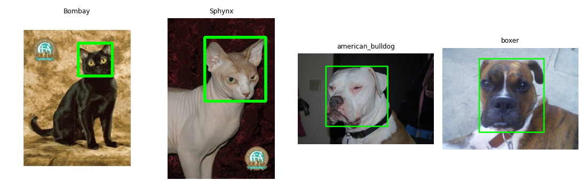

# Лабораторная 1: среда, репозиторий и первый взгляд на данные

**Вариант:** 15

## 1. Задача

Настроить среду, скачать данные своего варианта и составить сводку: форматы, режимы, размеры, наличие разметки. Заодно разобраться, как OpenCV хранит изображение (shape, dtype, порядок BGR).

## 2. Как запустить

Запускал в Google Colab. Перед Run All достаточно проверить, что в первой ячейке `solution.ipynb` стоит `VARIANT = 15`. Данные первая ячейка скачивает сама.

```bash
pip install -r requirements.txt
# откройте solution.ipynb, впишите VARIANT = 15 и выполните Run All
```

## 3. Данные

Вариант 15, четыре породы: кошки Bombay и Sphynx, собаки american_bulldog и boxer. Из датасета ничего не выкидывал: 800 изображений.

## 4. Результаты

| Что                                   |         Значение |
| ------------------------------------- | ---------------: |
| Файлов                                |              800 |
| Пород                                 |                4 |
| Кошек / собак                         |        400 / 400 |
| Ширина min / медиана / max            | 114 / 500 / 1725 |
| Высота min / медиана / max            | 103 / 375 / 1600 |
| Не в режиме RGB                       |                0 |
| `.jpg`, которые на самом деле не JPEG |                0 |
| Файлов с XML-боксом                   |              400 |



## 5. Выводы

- Все 800 файлов в режиме RGB и все `.jpg` действительно JPEG (0 проблемных), поэтому `cv2.imread` читает их одинаково и дополнительной конвертации в этом варианте не нужно.
- Размеры сильно разные: ширина от 114 до 1725 пикселей (медиана 500), высота от 103 до 1600 (медиана 375). Типичный кадр 500×375 при `cv2.resize(img, (224, 224))` сожмётся по ширине примерно в 2,2 раза, а по высоте в 1,7 раза, то есть заметно исказится.
- Бокс головы есть только у 400 из 800 изображений (50%), поэтому для задач с боксами в лабах 5–6 доступна лишь половина данных.
- Классы идеально сбалансированы: каждая из 4 пород (Bombay, Sphynx, american_bulldog, boxer) представлена 200 файлами, то есть самая крупная порода больше самой малой в 1 раз, перекоса нет.
