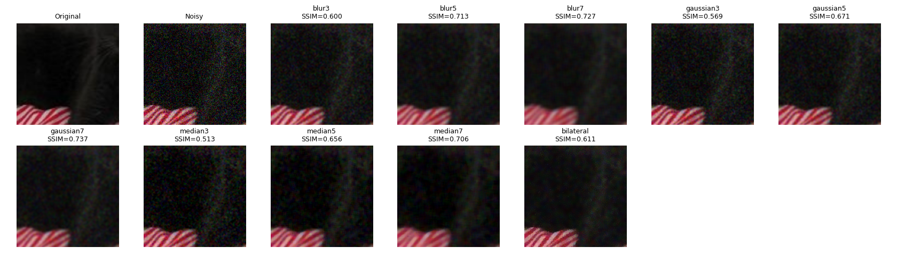
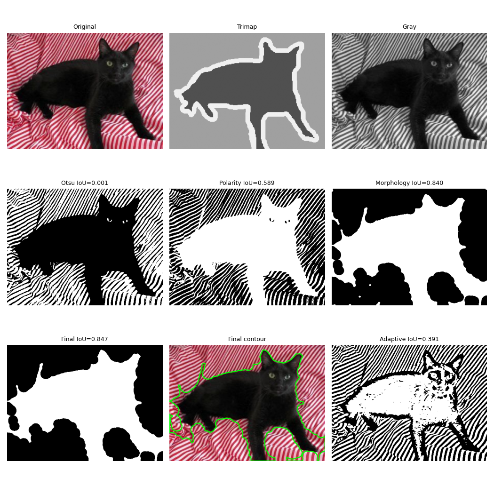
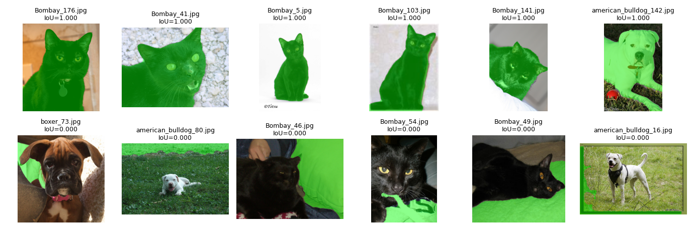

# Лабораторная 2: Обработка изображений и сегментация объектов

**Вариант:** 15

## 1. Задача

Исследовать освещённость и шум изображений, сравнить методы фильтрации, реализовать сегментацию животных с помощью пороговой обработки и морфологических операций, оценить качество масок относительно trimap.

## 2. Как запустить

Работа выполнена в Google Colab.

Для запуска необходимо открыть `solution.ipynb`, установить зависимости, указать `VARIANT = 15`, подготовить данные в соответствии со структурой, используемой в ноутбуке, и выполнить все ячейки последовательно (Run All).

```bash
pip install -r requirements.txt
```

## 3. Данные

Использован вариант 15: 800 изображений четырёх пород — `Bombay`, `Sphynx`, `american_bulldog`, `boxer`.

Данные использовались для исследования обработки изображений и сегментации. В работе применялся trimap для оценки качества полученных масок.

## 4. Результаты

| Что                                    |         Значение |
| -------------------------------------- | ---------------: |
| Количество изображений                 |              800 |
| Тип шума                               | Gaussian, σ = 30 |
| Лучший фильтр                          |     Gaussian 7×7 |
| PSNR лучшего фильтра                   |            28.51 |
| SSIM лучшего фильтра                   |            0.737 |
| Лучший канал сегментации               |             Gray |
| Средний IoU финальной сегментации      |            0.483 |
| Медианный IoU финальной сегментации    |            0.480 |
| Средний IoU только с Оцу               |            0.245 |
| Средний IoU после коррекции полярности |            0.440 |
| Средний IoU после морфологии           |            0.464 |

### Визуальные результаты

**Сравнение фильтров:**



**Этапы обработки и сегментации:**



**Лучшие и худшие результаты сегментации:**



## 5. Выводы

- Фильтр Gaussian 7×7 показал лучшие результаты среди проверенных методов: PSNR = 28.51, SSIM = 0.737.
- Канал Gray оказался эффективнее канала S: средний IoU составил 0.483 против 0.389.
- Наибольший прирост качества сегментации дала коррекция полярности маски: средний IoU вырос с 0.245 до 0.440.
- Морфологические операции повысили средний IoU с 0.440 до 0.464, а заливка отверстий и выбор крупнейшей компоненты — до 0.483.
- Кошки сегментировались лучше собак: средний IoU составил 0.513 против 0.452. Среди отдельных пород лучший результат показала Bombay (0.580), худший — boxer (0.413).
